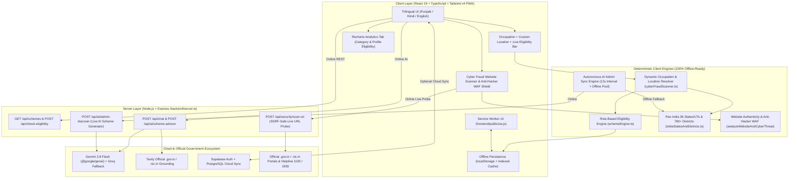
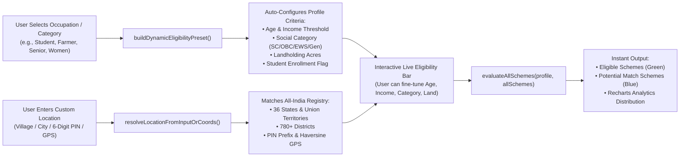
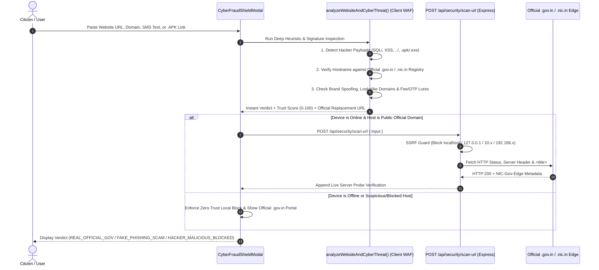
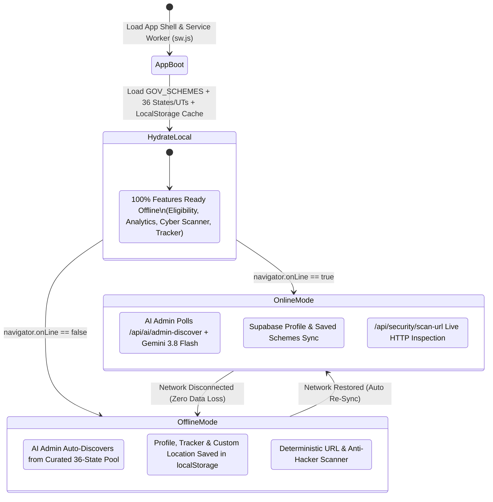

# System Architecture — JanSahayak AI (`ARCHITECTURE.md`)

**JanSahayak AI (ਪੰਜਾਬ ਅਤੇ ਭਾਰਤ ਸਰਕਾਰੀ ਸਕੀਮ ਨੈਵੀਗੇਟਰ)** is a **Hybrid Online + Offline Progressive Web Application (PWA)** engineered for pan-India citizen welfare discovery across all **36 States & Union Territories (28 States + 8 UTs)** and **780+ Districts**, featuring **Dynamic Occupation & Location Eligibility Matching** and an **Anti-Hacker & Website Authenticity Cyber Fraud Shield**.

---

## 1. High-Level Hybrid Online + Offline Architecture (Mermaid Diagram)

---

## 2. Dynamic Occupation, Category & Custom Location Eligibility Pipeline

Whenever a citizen selects an **Occupation** (`Student`, `Farmer`, `Homemaker / Women`, `Senior Citizen`, `Self-Employed`, `Daily Wage Worker`, `Unemployed Youth`), clicks a **Category**, or enters their **Custom Location** (`Village / City / Pincode / GPS`), the system dynamically computes tailored eligibility criteria and re-evaluates all Central and State schemes in `< 15ms`.

---

## 3. Cyber Fraud Website Scanner & Anti-Hacker WAF Shield Flow

The **Cyber Fraud Shield (`CyberFraudShieldModal.tsx` + `cyberFraudScanner.ts` + `POST /api/security/scan-url`)** protects citizens against fake phishing portals, WhatsApp/SMS fee scams, malicious `.apk` trojans, and hacker exploit payloads (`SQL Injection`, `XSS`, `Path Traversal`).

---

## 4. Hybrid Online / Offline & Autonomous AI Admin State Diagram

---

## 5. Directory & Module Responsibilities

| Layer | File Path | Responsibility |
| :--- | :--- | :--- |
| **Frontend Entry & State** | `/frontend/src/App.tsx` | Master state for Citizen Profile, Dynamic Occupation/Location Bar, All-State Schemes, and Navigation Tabs. |
| **Cyber Fraud & Presets** | `/frontend/src/utils/cyberFraudScanner.ts` | Website Authenticity & Anti-Hacker WAF (`analyzeWebsiteAndCyberThreat`), Dynamic Occupation Presets (`buildDynamicEligibilityPreset`), and Custom Location / PIN / GPS Resolver (`resolveLocationFromInputOrCoords`). |
| **Cyber Shield UI** | `/frontend/src/components/CyberFraudShieldModal.tsx` | Interactive Website Scanner UI, Trust Score meter (`0–100`), Website Technical Intelligence grid, and Blocked Exploit log. |
| **Recharts Analytics** | `/frontend/src/components/DashboardInsights.tsx` | Interactive grouped BarChart and Donut PieChart visualizing scheme distribution by category and user eligibility. |
| **All-India Dataset** | `/frontend/src/data/indiaStatesAndDistricts.ts` | Complete directory of 36 Indian States & UTs, 780+ districts, district helplines, and pan-India welfare schemes. |
| **Offline PWA Engine** | `/frontend/public/sw.js` | Service Worker caching app shell, static assets, and `/api/schemes` responses for offline resilience. |
| **Backend API Server** | `/backend/server.ts` | Express API serving `/api/schemes`, `/api/check-eligibility`, `/api/chat`, `/api/ai/admin-discover`, and `/api/security/scan-url`. |
