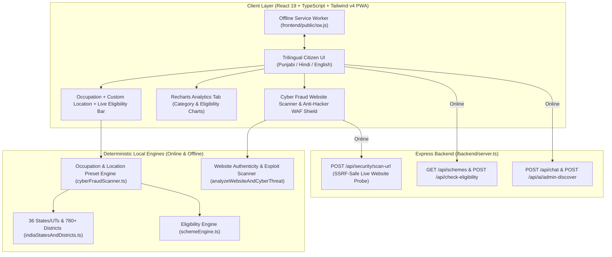
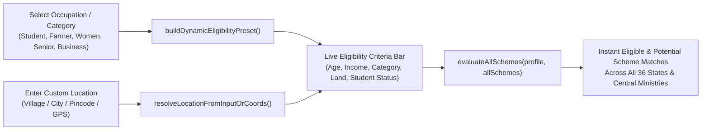
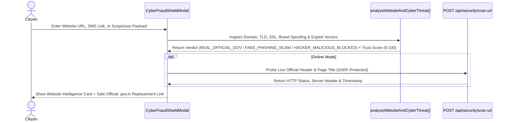

# System Architecture — JanSahayak AI (`artitecture.md`)

**JanSahayak AI (ਪੰਜਾਬ ਅਤੇ ਭਾਰਤ ਸਰਕਾਰੀ ਸਕੀਮ ਨੈਵੀਗੇਟਰ)** is a **Hybrid Online + Offline Progressive Web Application (PWA)** covering all **36 Indian States & Union Territories** and **780+ Districts**, with **Dynamic Occupation & Custom Location Eligibility** and an **Anti-Hacker Website Authenticity Scanner**.

---

## 1. Full-Stack Hybrid Architecture Diagram (Mermaid)

---

## 2. Dynamic Occupation, Category & Custom Location Eligibility Flow

---

## 3. Cyber Fraud Website Scanner & Anti-Hacker WAF Sequence

